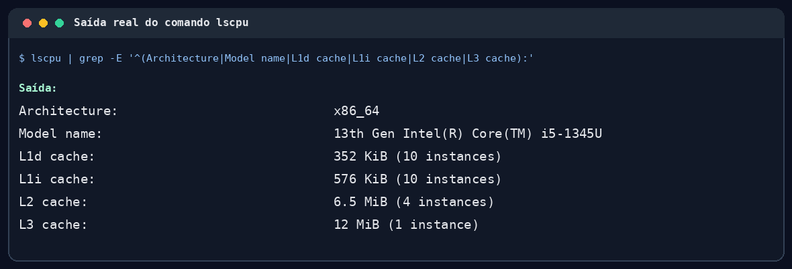
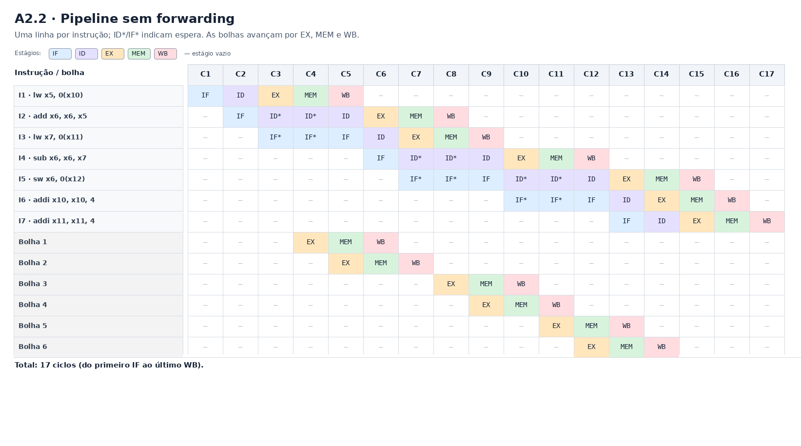
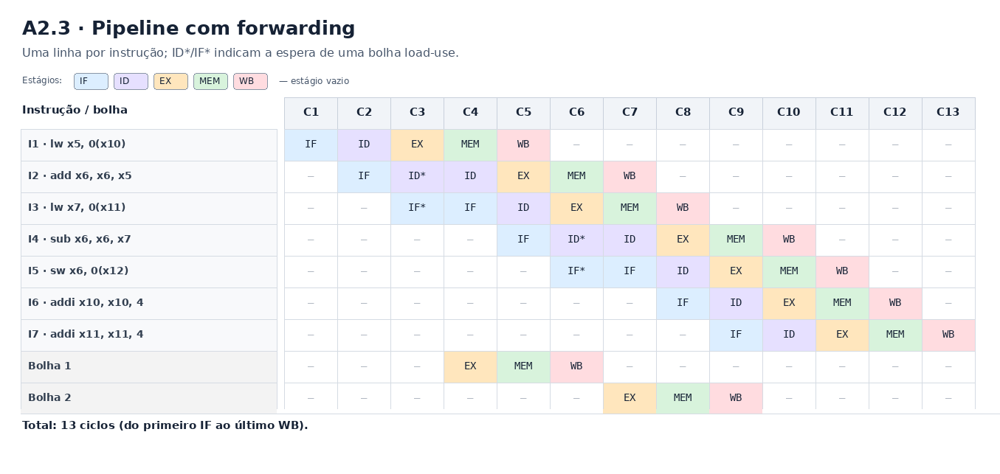
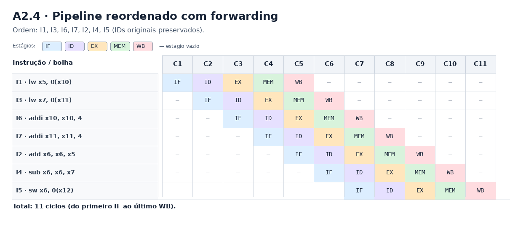
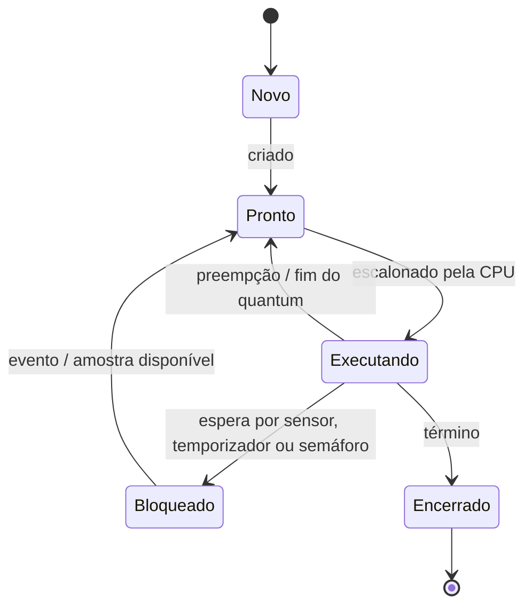

Christian Vinícius Gandra dos Santos | D1 = 9 | D2 = 2 | N = 5

# Ponderada CC08

## Parâmetros individuais

| Parâmetro | Conta | Valor |
| --- | --- | ---: |
| D1 | Letras de “Christian” | 9 |
| D2 | 9 + 8 + 6 + 3 + 6 = 32; último dígito | 2 |
| IC | 100.000 + 20.000 × 2 | 140.000 instruções/amostra |
| m | 3% + 0,5% × 9 | 7,5% |
| N | 3 + (2 mod 5) | 5 |

# Parte A — O problema técnico

## A1. Arquitetura e memória: qual processador vai na pulseira?

### Premissas de cálculo

- A Plataforma H opera a 48 MHz, tem CPI de 1,5 e acessa SRAM interna em 1 ciclo.
- A Plataforma V opera a 1,2 GHz; o acerto na cache custa 1 ciclo, a penalidade de falta é 120 ciclos e há 1,3 acessos à memória por instrução.
- O atraso máximo do sistema operacional na V é 3 ms; o limite por amostra é 5 ms.
- Para o DSP, a fração acelerada é 60% e o speedup dessa fração é 5; tempos finais em ms são arredondados a 3 casas decimais.

### A1.1 Plataforma H: tempo por amostra

> Calcule o tempo para processar uma amostra na Plataforma H, usando o seu IC. Ela atende os 5 ms?

**Dados usados:** IC = 140.000 instruções/amostra; CPI_H = 1,5 ciclos/instrução; f_H = 48 MHz.

**Passo 1: calcular os ciclos por amostra**

```text
Fórmula geral: C_H = IC × CPI_H
Substituindo: C_H = 140.000 instruções × 1,5 ciclos/instrução
Conta: C_H = 210.000 ciclos
```

**Passo 2: converter ciclos em tempo**

```text
Fórmula geral: T_H = C_H ÷ f_H
Substituindo: T_H = 210.000 ciclos ÷ (48 × 10⁶ ciclos/s)
Conta: T_H = 0,004375 s = 4,375 ms
```

**Resposta:** **4,375 ms < 5 ms; a Plataforma H atende**, com folga de 0,625 ms (12,5%).

### A1.2 Plataforma V: AMAT, CPI efetivo e tempo por amostra

> Para a Plataforma V, calcule o tempo médio de acesso à memória (AMAT) e o CPI efetivo, usando a sua taxa de falta m. Considere CPI efetivo = 1,0 + (acessos por instrução × m × penalidade). Calcule o tempo por amostra e o pior caso, somando o atraso do sistema operacional. Ela atende os 5 ms?

**Dados usados:** m = 7,5% = 0,075; acerto = 1 ciclo; penalidade = 120 ciclos; 1,3 acessos/instrução; IC = 140.000; f_V = 1,2 GHz; atraso máximo do SO = 3 ms.

**Passo 1: calcular AMAT**

```text
Fórmula geral: AMAT = tempo de acerto + (m × penalidade da falta)
Substituindo: AMAT = 1 ciclo + (0,075 × 120 ciclos)
Conta: AMAT = 1 + 9 = 10 ciclos por acesso, em média
```

**Passo 2: calcular CPI efetivo**

```text
Fórmula geral: CPI_efetivo = CPI_base + (acessos/instrução × m × penalidade)
Substituindo: CPI_efetivo = 1,0 + (1,3 × 0,075 × 120)
Conta: CPI_efetivo = 1,0 + 11,7 = 12,7 ciclos/instrução
```

**Passo 3: calcular o tempo médio por amostra**

```text
Fórmula geral: T_V = (IC × CPI_efetivo) ÷ f_V
Substituindo: T_V = (140.000 instruções × 12,7 ciclos/instrução) ÷ (1,2 × 10⁹ ciclos/s)
Conta: T_V = 1.778.000 ciclos ÷ (1,2 × 10⁹ ciclos/s) ≈ 0,001482 s ≈ 1,482 ms
```

**Passo 4: somar o atraso máximo do sistema operacional**

```text
Fórmula geral: T_pior = T_V + atraso máximo do SO
Substituindo: T_pior = 1,482 ms + 3 ms
Conta: T_pior = 4,482 ms
```

**Resposta:** **AMAT = 10 ciclos/acesso; CPI efetivo = 12,7; T_V = 1,482 ms; pior caso = 4,482 ms < 5 ms, atende**, com folga de 0,518 ms (10,4%). O tempo de processamento usa o CPI calculado pela taxa média de faltas; o atraso máximo do SO foi somado conforme pedido.

### A1.3 Plataforma H com DSP: Lei de Amdahl

> O time oferece um acelerador DSP para a Plataforma H que executa o filtro 5 vezes mais rápido. O filtro é 60% do tempo de processamento. Use a Lei de Amdahl para calcular o speedup global e o novo tempo por amostra. Agora atende?

**Dados usados:** fração acelerada p = 0,60; speedup dessa fração s = 5; tempo original T_H = 4,375 ms.

**Passo 1: calcular o speedup global**

```text
Fórmula geral: S = 1 ÷ [(1 − p) + (p ÷ s)]
Substituindo: S = 1 ÷ [(1 − 0,60) + (0,60 ÷ 5)]
Conta: S = 1 ÷ (0,40 + 0,12) = 1 ÷ 0,52 ≈ 1,923
```

**Passo 2: calcular o novo tempo**

```text
Fórmula geral: T_novo = T_original ÷ S
Substituindo: T_novo = 4,375 ms ÷ 1,923
Conta: T_novo ≈ 2,275 ms
```

**Resposta:** **Speedup global ≈ 1,923; novo tempo ≈ 2,275 ms < 5 ms; a Plataforma H com DSP atende**, com folga de 2,725 ms (54,5%).

### A1.4 Por que V precisa de cache e H funciona sem?

> Em até cinco linhas: por que a Plataforma V precisa de cache e a H funciona sem? Use a ideia de gargalo de Von Neumann.

- A V usa organização Von Neumann e faz 1,3 acessos à memória por instrução; sem cache, todos os acessos pagariam a latência da DRAM.
- Sem cache: CPI = 1,0 + (1,3 × 120) = 157; tempo = (140.000 × 157) ÷ 1,2 GHz ≈ 18,317 ms, acima de 5 ms.
- Com cache, CPI cai para 12,7 e o tempo médio estimado cai para 1,482 ms; o caminho compartilhado de instruções e dados continua sendo um gargalo.
- A H usa Harvard e SRAM interna de 1 ciclo, então não tem a grande diferença de latência da DRAM externa que a cache da V precisa compensar.

### A1.5 Evidência das caches da máquina

> Cole o print das caches do seu computador (Linux: lscpu; macOS: sysctl -a | grep cachesize; Windows: aba Caches do CPU-Z). A sua L1 é dividida em instruções e dados? Então o seu computador é Von Neumann ou Harvard? Justifique.



**O que o print mostra:** rodei `lscpu` em Linux nativo (Ubuntu; sem WSL ou hipervisor detectado). O processador é um Intel Core i5-1345U de 13ª geração. A saída informa L1d = 352 KiB (10 instâncias), L1i = 576 KiB (10 instâncias), L2 = 6,5 MiB (4 instâncias) e L3 = 12 MiB (1 instância). Os totais de L1 somam as 10 instâncias dos núcleos (2 de desempenho e 8 de eficiência).

**A L1 é dividida?** Sim. Há caches L1 separadas para dados (L1d) e instruções (L1i).

**Von Neumann ou Harvard?** A L1 é dividida (L1d e L1i); o `lscpu` também reporta L2 em quatro instâncias e L3 em uma instância. A memória principal é compartilhada por instruções e dados. Portanto, o computador tem organização **Harvard modificada**: Harvard na L1 e memória unificada na RAM.

## A2. Pipeline: o loop do filtro

### Premissas e legenda da A2

- O pipeline tem cinco estágios: IF (busca), ID (decodificação/leitura de registradores), EX (execução), MEM (memória) e WB (escrita do resultado).
- Em um mesmo ciclo, WB escreve na primeira metade e ID pode ler na segunda metade.
- Sem forwarding, um consumidor só sai de ID depois da escrita do produtor em WB. Com forwarding, resultados de ALU podem ser encaminhados entre estágios; considera-se também o encaminhamento do dado de `sw`.
- `ID*` e `IF*` indicam que a instrução está mantida naquele estágio durante uma espera. **Bolha** é uma entrada vazia inserida no pipeline e avança por EX, MEM e WB. `—` significa somente que a célula/estágio está vazio.

| Distância entre produtora e consumidora | Bolhas sem forwarding |
| --- | ---: |
| 1 (instruções adjacentes) | 2 |
| 2 (uma instrução no meio) | 1 |
| 3 ou mais | 0 |

### A2.1 Dependências de dados RAW

> Liste as dependências de dados (RAW) do trecho: qual instrução depende de qual, por qual registrador.

Uma dependência RAW (Read After Write) ocorre quando uma instrução precisa ler um registrador escrito por uma instrução anterior. No trecho, as dependências são:

| Instrução que escreve | Instrução que lê | Registrador | Valor transmitido |
| --- | --- | --- | --- |
| 1. `lw x5, 0(x10)` | 2. `add x6, x6, x5` | `x5` | Amostra nova lida do sensor |
| 2. `add x6, x6, x5` | 4. `sub x6, x6, x7` | `x6` | Soma atualizada com a amostra nova |
| 3. `lw x7, 0(x11)` | 4. `sub x6, x6, x7` | `x7` | Amostra mais antiga do buffer |
| 4. `sub x6, x6, x7` | 5. `sw x6, 0(x12)` | `x6` | Soma final a ser gravada |

As instruções 6 e 7 atualizam os ponteiros `x10` e `x11` depois dos loads. Não criam dependência RAW com instrução posterior no trecho; ao reordená-las, mantenho cada incremento depois do load que usa aquele ponteiro.

### A2.2 Pipeline sem forwarding

> Sem forwarding: desenhe o diagrama do pipeline ciclo a ciclo e diga quantos ciclos o trecho leva do primeiro IF ao último WB.

No trecho original, `I1 → I2` (`x5`) tem distância 1 e exige 2 bolhas; `I3 → I4` (`x7`) também tem distância 1 e exige 2. Para I4, há ainda `I2 → I4` (`x6`), com distância 2 e exigência de 1 bolha. Como I4 precisa dos dois operandos, vale a dependência mais restritiva: 2 bolhas, não a soma 2 + 1. Por fim, `I4 → I5` (`x6`) tem distância 1 e exige 2. Total: 6 bolhas.



O pipeline ideal de 7 instruções leva `7 + (5 − 1) = 11` ciclos. As seis bolhas elevam o total a 17 ciclos.

**Resposta:** **11 + 6 = 17 ciclos**, do primeiro IF de I1 ao último WB de I7.

### A2.3 Pipeline com forwarding

> Com forwarding: mesmo diagrama e total. Qual dependência continua causando bolha mesmo com forwarding, e por quê?

Com forwarding, resultados podem ser encaminhados sem esperar pela escrita e leitura no banco de registradores. Ainda ocorre uma bolha em cada dependência load-use (`I1 → I2` para `x5` e `I3 → I4` para `x7`): o `lw` só disponibiliza o dado ao fim de MEM, mas a instrução seguinte precisa dele no início de EX, no mesmo ciclo em que o `lw` está em MEM. O caminho de forwarding não consegue levar o dado para trás no tempo; por isso resta uma bolha por load-use.



O pipeline ideal leva 11 ciclos; as duas bolhas load-use acrescentam 2 ciclos.

**Resposta:** **13 ciclos** (11 + 2), com uma bolha em cada dependência load-use.

### A2.4 Reordenação sem bolhas com forwarding

> Reordene as instruções, sem mudar o resultado, para eliminar todas as bolhas com forwarding. Mostre a nova ordem e o novo total de ciclos.

Aproveito as instruções independentes para separar cada `lw` de seu consumidor. A sequência abaixo mantém os IDs originais: I1, I3, I6, I7, I2, I4, I5.

| Ordem | Instrução original | Instrução |
| ---: | --- | --- |
| 1 | I1 | `lw x5, 0(x10)` |
| 2 | I3 | `lw x7, 0(x11)` |
| 3 | I6 | `addi x10, x10, 4` |
| 4 | I7 | `addi x11, x11, 4` |
| 5 | I2 | `add x6, x6, x5` |
| 6 | I4 | `sub x6, x6, x7` |
| 7 | I5 | `sw x6, 0(x12)` |

Os `addi` só alteram ponteiros usados pelos `lw`, que já foram executados antes deles; assim, os endereços lidos não mudam. Além disso, as operações sobre `x6` mantêm a ordem `add → sub → sw`, preservando o resultado. Com forwarding, `add → sub` e `sub → sw` não exigem bolhas.



**Resposta:** a reordenação preserva o resultado e elimina as bolhas com forwarding. O total é `7 + (5 − 1) =` **11 ciclos**.

## A3. Processos e threads: como organizar o software

### A3.1 Organização das quatro tarefas

> Proponha quais tarefas serão threads de um mesmo processo e quais serão processos separados. Justifique considerando compartilhamento de memória, custo de criação e troca de contexto e isolamento de falhas.

Manteria leitura do sensor, processamento e vibração como threads persistentes do processo `controle_tato`, formando o **caminho crítico de tempo real**. O BLE roda em um processo separado. Nenhuma thread é criada por amostra.

| Tarefa | Organização proposta | Motivo principal |
| --- | --- | --- |
| Ler o sensor | Thread `sensor` em `controle_tato` | Lê cada amostra e a publica rapidamente no buffer do processo de controle. |
| Processar a amostra | Thread `processamento` em `controle_tato` | Calcula a resposta usando os dados compartilhados, sem serialização entre processos. |
| Acionar o motor | Thread `vibracao` em `controle_tato` | Aplica a resposta sem depender da conexão BLE. |
| Comunicar com o celular por BLE | Processo `ble`, com threads próprias de log e configuração | Mantém o tratamento dos dados externos fora do espaço de memória do controle. |

**Compartilhamento de memória:** as três threads de controle compartilham o buffer de amostras e os dados de vibração no mesmo processo, com sincronização curta. O BLE usa um socket Unix (`AF_UNIX`) com mensagens limitadas: o kernel copia os dados entre processos e cada lado valida tamanho, tipo e faixa dos campos. Não há região de memória compartilhada entre BLE e controle.

**Custo de criação e troca de contexto:** threads persistentes são mais leves que processos e evitam criar uma thread por amostra. Pela A1, a V leva 1,482 ms por amostra em média e chega a 4,482 ms no pior caso, incluindo até 3 ms de atraso do Linux: sobram só 0,518 ms do limite de 5 ms. Por isso, transferências entre as três threads e suas trocas de contexto precisam ser curtas; logs e comandos BLE ficam fora desse caminho. Usaria prioridade de tempo real, como `SCHED_FIFO`, com rotinas curtas e limitadas para não monopolizar a CPU.

**BLE sem bloquear o controle:** o processo de controle envia logs ao socket de forma não bloqueante. A fila de saída é limitada; se estiver cheia ou o BLE estiver lento, descarta-se o log e contabiliza-se a perda, sem esperar pelo celular. Comandos recebidos entram como mensagens validadas e são aplicados pelo controle em um ponto seguro do ciclo.

**Isolamento de falhas e recuperação:** as três threads de controle compartilham memória, então uma falha nelas ainda pode parar o processo inteiro. O BLE separado pode ser encerrado e reiniciado sem encerrar diretamente a vibração. Um supervisor externo monitora o processo `controle_tato` e o reinicia se ele cair; durante a reinicialização, a pulseira sinaliza a interrupção com um pulso longo, como no watchdog do Dilema 1.

**Compatibilidade com a A5:** `thread_sensor` fica em `controle_tato`; `thread_log` e `thread_config` ficam no processo `ble`. `thread_config` não acessa diretamente o barramento I2C: pede o ajuste ao processo de controle pelo socket Unix. Para representar o deadlock da A5, os semáforos nomeados `i2c`, `log` e `ble` são compartilhados pelo kernel entre os processos: `thread_sensor` pode deter `i2c` e esperar `log`; `thread_log`, no processo BLE, pode deter `log` e esperar `ble`; e `thread_config`, também no BLE, pode deter `ble` e esperar o semáforo `i2c` antes de pedir o ajuste ao controle. Isso modela a implementação defeituosa sem compartilhar a região de dados. Na implementação recomendada, o controle não espera por IPC enquanto mantém outro recurso bloqueado.

**Resposta:** leitura do sensor, processamento e vibração são threads persistentes de `controle_tato`; BLE é processo separado e troca mensagens copiadas e validadas por socket Unix não bloqueante.

### A3.2 Falha explorada no módulo BLE

> Se alguém explorar uma falha no módulo BLE, que diferença faz ele ser uma thread ou um processo separado?

| Aspecto | BLE como thread de `controle_tato` | BLE como processo separado |
| --- | --- | --- |
| Memória alcançável | Pode acessar amostras, buffer e configurações do processo de controle. | Fica no espaço de memória próprio; recebe só mensagens pelo socket Unix. |
| Efeito de travamento | Pode derrubar o processo inteiro, inclusive a vibração. | A conexão BLE pode parar, mas o controle tende a continuar. |
| Contenção | Usa as permissões do processo de controle. | Pode rodar com usuário sem privilégios e permissões/filtro de chamadas reduzidos. |
| Custo | Não acrescenta IPC entre BLE e controle. | Acrescenta cópia, IPC e validação das mensagens. |

O BLE separado reduz o impacto de uma exploração, mas não elimina falhas no sistema operacional, mensagens abusivas ou erros na validação. A latência adicional é aceitável porque logs e configurações não estão no caminho de vibração da amostra; o envio de log é não bloqueante.

**Resposta:** como processo separado, uma falha no BLE fica mais contida e não ganha acesso direto à memória crítica; paga-se o custo de IPC fora do caminho de tempo real.

### A3.3 Estados de um processo e estado da thread do sensor

> Desenhe o diagrama de estados de um processo. Em qual estado a thread do sensor passa a maior parte do tempo? Por quê?



Pela A1, o processamento na V leva 1,482 ms em média a cada período de 10 ms: `1,482 ÷ 10 × 100 ≈ 14,8%` do período. A leitura e publicação do sensor usam menos CPU que o processamento completo. A thread `sensor` passa a maior parte do tempo **Bloqueada**, aguardando a próxima amostra ou o temporizador; então percorre `Bloqueado → Pronto → Executando → Bloqueado`. O tempo em Pronto é quando aguarda a CPU; a A1 considera que o atraso do Linux pode chegar a 3 ms.

**Resposta:** a thread `sensor` passa a maior parte do tempo **Bloqueada**, esperando o próximo evento de amostragem; o processamento médio ocupa cerca de **14,8%** de cada período de 10 ms.

## A4. Código com semáforos

## A5. Deadlock

# Parte B — A decisão do CTO
